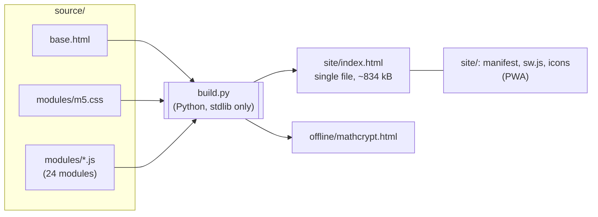
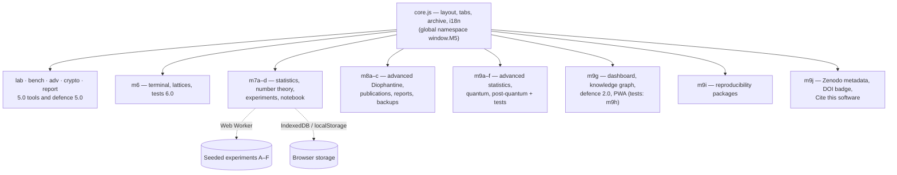
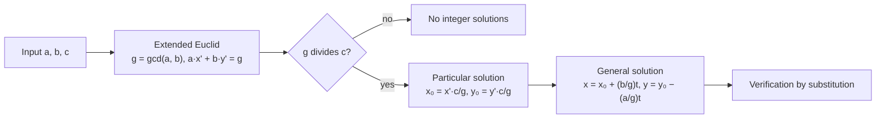
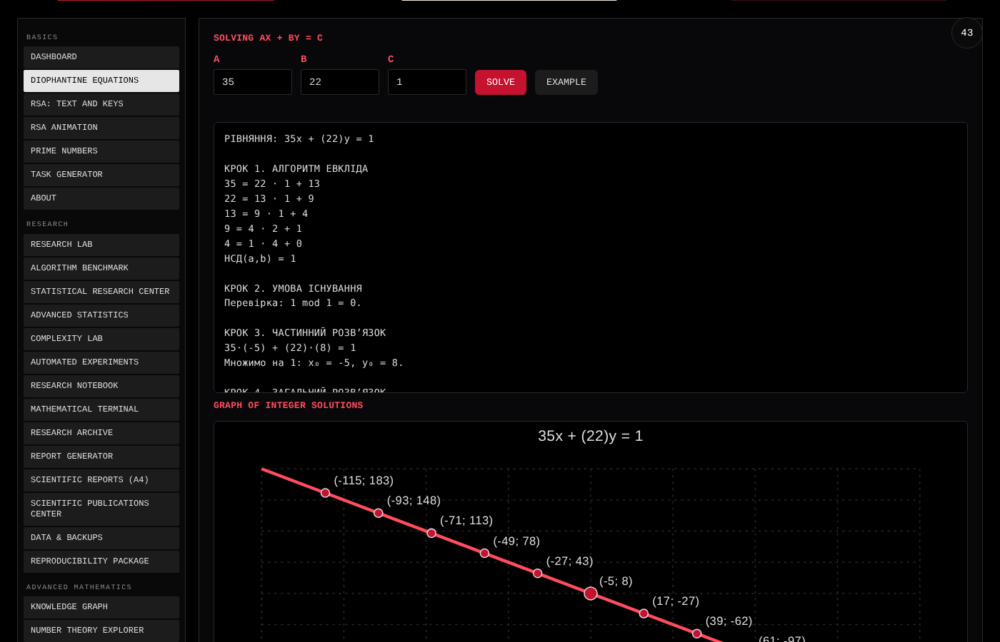
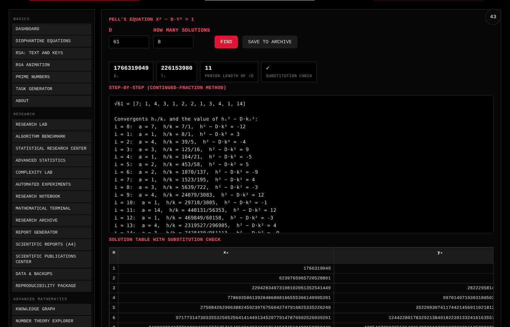
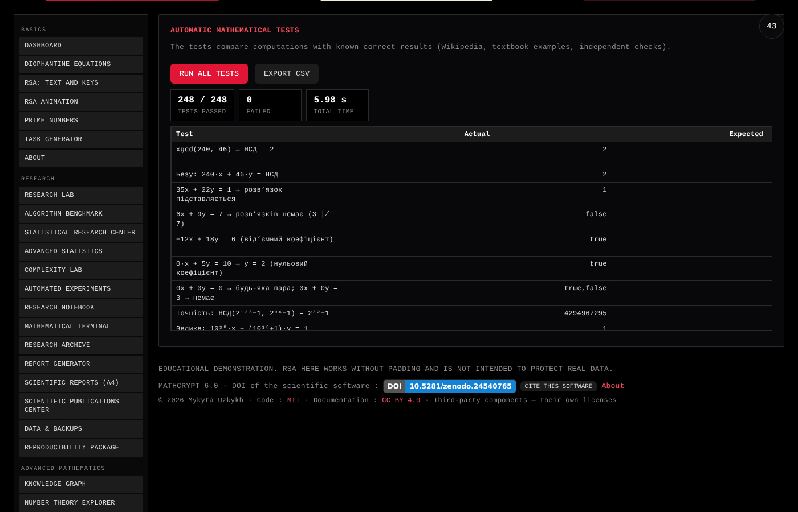
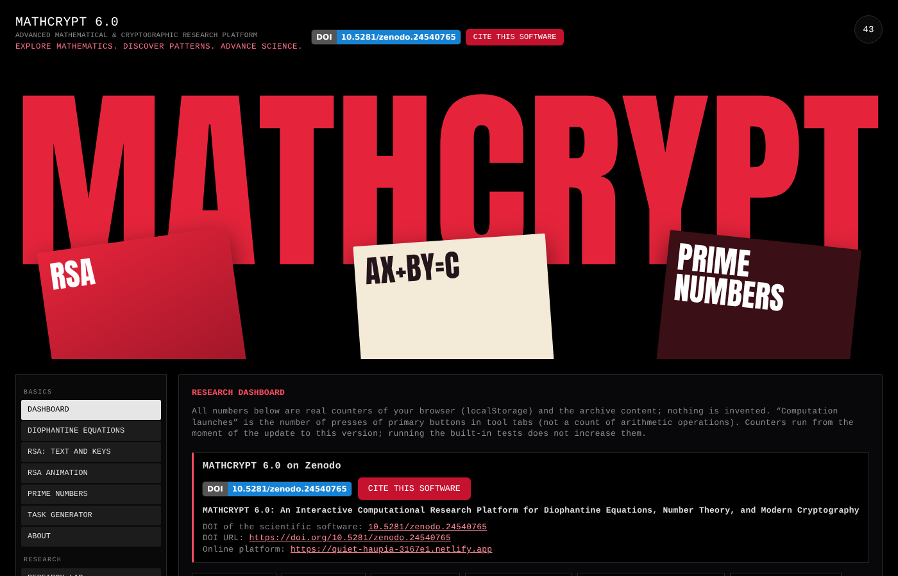

# MATHCRYPT 6.0

**An Interactive Computational Research Platform for Diophantine Equations, Number Theory, and Modern Cryptography**

[](https://doi.org/10.5281/zenodo.24540765)
[](LICENSE)
[](LICENSE-DOCS.md)
[](https://orcid.org/0009-0001-7704-8083)
[](CHANGELOG.md)

MATHCRYPT is a single-file, offline-capable browser application for studying Diophantine equations,
number theory, lattices and cryptography with exact integer arithmetic, step-by-step explanations,
automated self-tests and reproducible experiments. The interface is available in Ukrainian and English.

| | |
|---|---|
| **Author** | Mykyta Uzkykh ([ORCID 0009-0001-7704-8083](https://orcid.org/0009-0001-7704-8083)) |
| **Version** | 6.0.0 (published on Zenodo on 25 November 2026) |
| **DOI** | [10.5281/zenodo.24540765](https://doi.org/10.5281/zenodo.24540765) — software deposit, not a peer-reviewed publication |
| **Online platform** | https://quiet-haupia-3167e1.netlify.app |
| **Status** | Research and educational software |

> [!WARNING]
> MATHCRYPT is **educational and research software**. Its cryptographic components (textbook RSA without
> padding, toy LWE / Module-LWE, Lamport signatures, simplified ML-KEM building blocks, classical ciphers)
> are **not** secure implementations and must **not** be used to protect real data. MATHCRYPT has not been
> independently audited or certified.

## Contents

[Abstract](#abstract) · [Scientific background](#scientific-background) · [Research objectives](#research-objectives) ·
[Mathematical foundations](#mathematical-foundations) · [Software architecture](#software-architecture) ·
[Implemented algorithms](#implemented-algorithms) · [Installation](#installation) · [Usage](#usage) ·
[Screenshots](#screenshots) · [Testing and validation](#testing-and-validation) · [Limitations](#limitations) ·
[Reproducibility](#reproducibility) · [Citation](#citation) · [Author](#author) · [License](#license) ·
[Future research](#future-research)

## Abstract

MATHCRYPT 6.0 is an interactive computational environment for studying Diophantine equations, number
theory, computational mathematics, statistics, lattice theory and cryptography. It was developed as part of
a research project within the Junior Academy of Sciences of Ukraine. It provides exact-arithmetic
tools for linear Diophantine equations and systems over $\mathbb{Z}$ (Smith and Hermite normal forms),
Pell equations, continued fractions, the Chinese remainder theorem and lattice reduction (LLL), together
with educational modules on RSA, Diffie–Hellman, elliptic curves, hash functions, post-quantum cryptography
and classically simulated quantum algorithms. Six seeded experiments can be exported as reproducibility
packages with SHA-256 checksums. The built-in suite of **248 automated tests** compares results against
textbook values, invariants and independent SciPy/NumPy references; it passes in Chromium.

## Scientific background

Linear Diophantine equations $ax + by = c$ are among the oldest problems of number theory. Their complete
solution rests on the Euclidean algorithm and Bézout's identity. The same tools — greatest common divisors,
modular inverses and the Chinese remainder theorem — form the arithmetic core of public-key cryptography:
the RSA private exponent is the solution of the Diophantine equation $e d - \varphi(n) k = 1$.
Modern post-quantum schemes replace factoring-based assumptions with lattice problems, which brings integer
linear algebra (Smith and Hermite normal forms, lattice reduction) to the centre of cryptography. MATHCRYPT
connects these topics in one environment so that each step can be computed, inspected and verified.

## Research objectives

1. Implement exact algorithms for linear Diophantine equations, systems over $\mathbb{Z}$, congruences and
   Pell equations, with every result verified by substitution.
2. Show the link between elementary number theory and cryptography (RSA, Diffie–Hellman, elliptic curves)
   through step-by-step, inspectable computations.
3. Introduce lattice-based and post-quantum concepts (LLL, LWE, Module-LWE, the ML-KEM NTT) on toy
   parameters, with explicit statements of what is and is not implemented.
4. Make computational experiments reproducible: fixed seeds, recorded parameters, exportable data and
   checksums.
5. Validate the implementation with automated tests against independent references.

## Mathematical foundations

A full summary with proofs sketches and examples is in [`docs/MATHEMATICAL_FOUNDATIONS.md`](docs/MATHEMATICAL_FOUNDATIONS.md).
The central results used by the platform:

**Solvability of linear Diophantine equations.** With $g = \gcd(a,b)$,

$$
ax + by = c \ \text{ is solvable in } \mathbb{Z} \iff g \mid c, \qquad
(x, y) = \Big(x_0 + \tfrac{b}{g}t,\; y_0 - \tfrac{a}{g}t\Big),\ t \in \mathbb{Z}.
$$

**Systems over the integers** via the Smith normal form $UAV = D = \operatorname{diag}(d_1, \dots, d_r, 0, \dots)$,
$d_1 \mid d_2 \mid \dots \mid d_r$, with unimodular $U, V$: the system $Ax = b$ is solvable iff
$d_i \mid (Ub)_i$ for $i \le r$ and $(Ub)_i = 0$ for $i > r$.

**Pell's equation** $x^2 - Dy^2 = 1$ is solved through the periodic continued fraction of $\sqrt{D}$.

**Textbook RSA**: $n = pq$, $ed \equiv 1 \pmod{\varphi(n)}$, $c \equiv m^e$, $m \equiv c^d \pmod n$.

**Learning With Errors**: $\mathbf{b} = A\mathbf{s} + \mathbf{e} \pmod q$ with small error $\mathbf{e}$.

## Software architecture

The application is plain HTML, CSS and JavaScript with no framework and no runtime dependencies. A Python
script concatenates the modules into one self-contained HTML file. Details: [`docs/ARCHITECTURE.md`](docs/ARCHITECTURE.md).





| Path | Content |
|---|---|
| `source/` | Editable sources: `base.html`, `modules/*.js`, `modules/m5.css`, `build.py` |
| `site/` | Built application for static hosting (`index.html`, PWA manifest, service worker, icons) |
| `offline/mathcrypt.html` | The same build for opening directly from disk |
| `tests/` | Browser test scripts (Playwright), reference generators (`refs/`), Python tests (`python/`), recorded results |
| `docs/` | Architecture, algorithms, mathematical foundations, test report, limitations, reproduction guide |
| `examples/` | Worked examples and an independent Python reference implementation |
| `assets/screenshots/` | Screenshots of version 6.0.0 |

## Implemented algorithms

| Area | Implemented |
|---|---|
| Diophantine equations | Linear $ax+by=c$; $\ge 3$ variables; systems over $\mathbb{Z}$ (Smith / Hermite normal forms, verified by substitution); congruence systems; bounded integer optimisation; Pell equations; bounded search for non-linear equations (clearly distinguished from proofs of non-existence) |
| Number theory | Euclid (steps, extended, binary), continued fractions, CRT (including non-coprime moduli), $\varphi,\ \mu,\ \tau,\ \sigma$, Carmichael $\lambda$, Jacobi/Legendre symbols, primitive roots, Miller–Rabin, Lucas–Lehmer, sieves, factorisation, proof centre |
| Cryptography (educational) | Textbook RSA, Diffie–Hellman, elliptic curves over $\mathbb{F}_p$, SHA-256/512 (own implementation, compared with Web Crypto), classical ciphers |
| Lattices | Lagrange–Gauss reduction, exact-rational LLL |
| Post-quantum (educational) | LWE, Module-LWE, ML-KEM NTT ($q = 3329,\ \zeta = 17$), Kannan-embedding attack on toy LWE, Lamport signature, FIPS 203/204/205 size tables |
| Quantum (classical simulation) | State-vector simulator, Bloch sphere, standard gates, entanglement, QFT, Grover, Shor order finding |
| Statistics | Descriptive statistics, Shapiro–Wilk, Mann–Whitney, Wilcoxon, Kruskal–Wallis, ANOVA, bootstrap (percentile, BCa), OLS / polynomial / Huber regression, power analysis |
| Research tools | Seeded experiments A–F (Web Worker), notebook (IndexedDB), A4 reports, publications centre (BibTeX / RIS / JSON), reproducibility packages, backups |

Algorithm notes: [`docs/ALGORITHMS.md`](docs/ALGORITHMS.md). Worked examples: [`examples/`](examples/README.md).

### Example: solving $35x + 22y = 1$



$\gcd(35, 22) = 1$; back-substitution gives $35 \cdot (-5) + 22 \cdot 8 = 1$, hence
$x = -5 + 22t,\ y = 8 - 35t$. More examples (Pell, CRT, RSA, continued fractions) are in
[`examples/README.md`](examples/README.md).

## Installation

No installation is required to **use** MATHCRYPT.

| Option | How |
|---|---|
| Online | Open https://quiet-haupia-3167e1.netlify.app |
| From disk | Download the repository (or the release asset `mathcrypt-6.0.0.html`) and open `offline/mathcrypt.html` in a current browser. No internet connection is needed. |
| Own hosting | Upload the whole `site/` folder to any static host (for example Netlify). See [`docs/NETLIFY.md`](docs/NETLIFY.md). |

For **development** (building and testing):

```bash
git clone https://github.com/mykytauzkykh-dotcom/MATHCRYPT.git
cd MATHCRYPT
python3 -m pip install -r requirements.txt     # pytest, PyYAML (+ NumPy/SciPy for tests/refs)
npm install                                    # Playwright (browser tests only)
npx playwright install chromium
```

## Usage

```bash
python3 source/build.py                         # rebuild site/index.html and offline/mathcrypt.html
node tests/run_builtin_suite.js site/index.html # run the 248 built-in tests in Chromium
python3 -m pytest tests/python -v               # Python tests: build reproducibility, metadata, reference values
node tests/check_syntax.js                      # syntax check of all JavaScript modules
```

In the application, start from the **Dashboard** or pick a tab in the sidebar (43 tabs). Every tool shows its
intermediate steps; results can be saved to the research archive or notebook, exported as CSV/JSON, or put
into an A4 report. Edit sources only in `source/` — `site/index.html` is generated.

## Screenshots

Screenshots of version 6.0.0 in Chromium (English interface). The step-by-step output of the original
equation solver and the names of the built-in tests are in Ukrainian.

| Linear Diophantine solver | Pell equation |
|---|---|
|  |  |
| **Automatic tests (248 / 248)** | **Dashboard** |
|  |  |

## Testing and validation

| Check | Result | Evidence |
|---|---|---|
| Built-in suite (`M5.runTests()`), Chromium 158 | **248 / 248 passed** (26 Nov 2026) | [`tests/test_results.json`](tests/test_results.json), [`docs/TEST_REPORT.md`](docs/TEST_REPORT.md) |
| Same suite re-run independently on Chromium 153 | **248 / 248 passed**, no console errors (27 Nov 2026) | `node tests/run_builtin_suite.js` |
| Reproducible build | `build.py` regenerates `site/index.html` byte-for-byte | `tests/python/test_repository.py` |
| Python reference values | 22 test cases recomputing the published examples with an independent implementation | `tests/python/test_reference_values.py` |
| Duplicate DOM ids / 390 px layout | none / no horizontal overflow in all 43 tabs | `tests/t9.js`, `tests/t29.js` |
| Security payload audit | no injected script executed | `tests/t26.js`, [`SECURITY.md`](SECURITY.md) |
| Offline (Service Worker) | 248 / 248 offline | `tests/t24.js` |

How the 248 tests are distributed: 139 from stages 1–2 (number theory, Diophantine equations, RSA,
ciphers, statistics, proofs, visualiser, experiments), 31 from stage 3a (Smith/Hermite forms, systems,
publications, reports, backups), 48 from stage 3b (statistics vs SciPy, quantum vs NumPy, post-quantum),
14 from stage 3c (knowledge graph, dashboard, defence mode, PWA), 10 in the final stage (ZIP/CRC,
reproducibility packages, hostile input, SVG sanitiser, resource limits) and 6 for the Zenodo citation
metadata.

**What the tests do not establish:** browser compatibility beyond Chromium (Firefox and Safari are untested),
cryptographic security, or correctness for inputs outside the tested ranges. The test results are the
author's own verification, not an independent certification. The Zenodo record description refers to the
earlier run of 24 November 2026 (242 tests); the HTML file deposited on Zenodo is byte-identical to
`site/index.html` in this repository (MD5 `cdb47e0108b0677c7cf6ce16e048249e`), whose suite contains 248 tests.

## Limitations

The full list is in [`docs/KNOWN_LIMITATIONS.md`](docs/KNOWN_LIMITATIONS.md). The most important:

* **Educational cryptography.** RSA is textbook RSA without padding; LWE and Module-LWE use toy parameters;
  the ML-KEM components are building blocks, not FIPS 203. FIPS 203/204/205 are described, not implemented.
  Nothing is constant-time; JavaScript `BigInt` is not designed for side-channel resistance; the browser
  random generator is used only for demonstrations.
* **Quantum lab** is a classical simulation with exponential cost (about 12 qubits interactively).
* **Non-linear Diophantine equations** are explored by bounded search only: “no solutions found” is not a
  proof of non-existence (except where a modular obstruction is shown).
* **Statistics:** Shapiro–Wilk uses Royston's approximation ($3 \le n \le 5000$); exact Mann–Whitney and
  Wilcoxon only for small samples; the program never writes scientific conclusions.
* **Platform:** only Chromium was tested; heavy inputs can block the main thread for a few seconds; no
  formal security audit and no Content Security Policy; browser storage is not encrypted.

## Reproducibility

* Experiments A–F use a seeded `mulberry32` generator; the same version, parameters and seed give identical data.
* A **reproducibility package** (ZIP) contains data (JSON, CSV), parameters, seed, version, methodology,
  charts, FNV-1a and SHA-256 checksums and instructions; it can be re-imported and re-run.
  Check integrity outside the program with `sha256sum -c checksums.sha256`.
* The build is deterministic: `python3 source/build.py` reproduces the committed `site/index.html` exactly.
* Reference values from SciPy 1.18.1 / NumPy 2.5.3 are regenerated by `tests/refs/*.py`.

Guide: [`docs/REPRODUCTION.md`](docs/REPRODUCTION.md).

## Citation

Please cite the archived version. GitHub's **“Cite this repository”** button uses [`CITATION.cff`](CITATION.cff).

**APA (7th ed.)**

> Uzkykh, M. (2026). *MATHCRYPT 6.0: An Interactive Computational Research Platform for Diophantine Equations, Number Theory, and Modern Cryptography* (Version 6.0.0) [Computer software]. Zenodo. https://doi.org/10.5281/zenodo.24540765

**BibTeX**

```bibtex
@software{uzkykh_2026_24540765,
  author    = {Uzkykh, Mykyta},
  title     = {{MATHCRYPT 6.0: An Interactive Computational Research Platform for Diophantine Equations, Number Theory, and Modern Cryptography}},
  year      = {2026},
  month     = nov,
  publisher = {Zenodo},
  version   = {6.0.0},
  doi       = {10.5281/zenodo.24540765},
  url       = {https://doi.org/10.5281/zenodo.24540765}
}
```

**IEEE**

> M. Uzkykh, “MATHCRYPT 6.0: An Interactive Computational Research Platform for Diophantine Equations, Number Theory, and Modern Cryptography,” version 6.0.0, Zenodo, 2026. doi: 10.5281/zenodo.24540765.

## Author

**Mykyta Uzkykh** — student researcher, Kharkiv, Ukraine
Kharkiv Private Lyceum “Kharkiv Collegium” · ORCID [0009-0001-7704-8083](https://orcid.org/0009-0001-7704-8083) ·
Portfolio https://mykyta-uzkykh.netlify.app

Supervisor (as listed in the Zenodo record): Dmytro Alexandrov, V. N. Karazin Kharkiv National University.

## License

| Material | License |
|---|---|
| Original program code (`source/`, `site/`, `offline/`, test scripts, `examples/*.py`, build script) | [MIT](LICENSE), © 2026 Mykyta Uzkykh |
| Original documentation and user guide (`docs/`, README files, CHANGELOG, CONTRIBUTING, SECURITY, screenshots) | [CC BY 4.0](LICENSE-DOCS.md), © 2026 Mykyta Uzkykh |
| Third-party components (three.js, the Anton font, development tools) | Their own licenses — see [`THIRD_PARTY_NOTICES.md`](THIRD_PARTY_NOTICES.md) |

## Future research

Directions under consideration (not implemented in 6.0.0):

* Testing in Firefox and Safari and adding them to continuous integration.
* Moving long main-thread computations (factorisation, large Fibonacci numbers) to Web Workers.
* Comparing the Diophantine and lattice algorithms with established computer-algebra systems
  (for example PARI/GP or SageMath) on larger benchmark sets.
* Extending the lattice module (BKZ, enumeration) for experiments on small LWE instances.
* A full English translation of the remaining Ukrainian-only outputs.

---

*Ukrainian version: [`README_UK.md`](README_UK.md). Changes: [`CHANGELOG.md`](CHANGELOG.md). Security policy: [`SECURITY.md`](SECURITY.md).*
